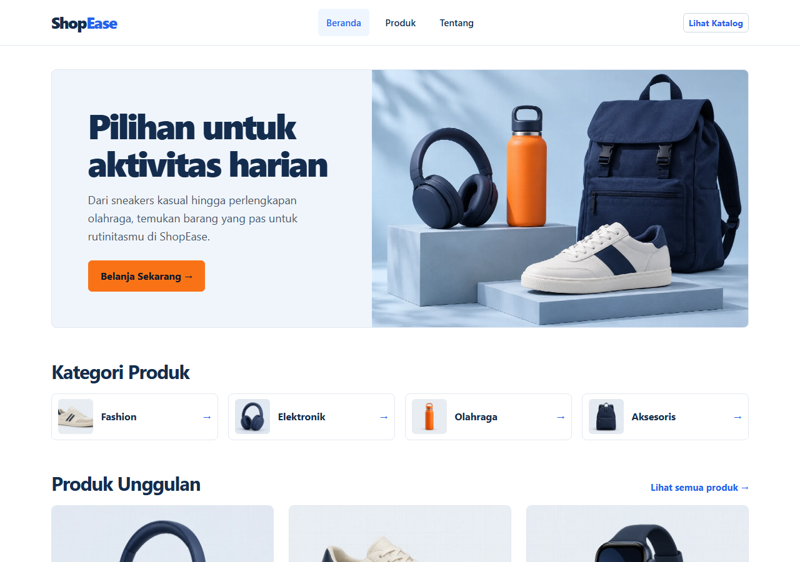
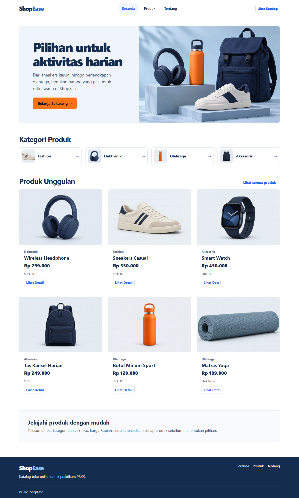
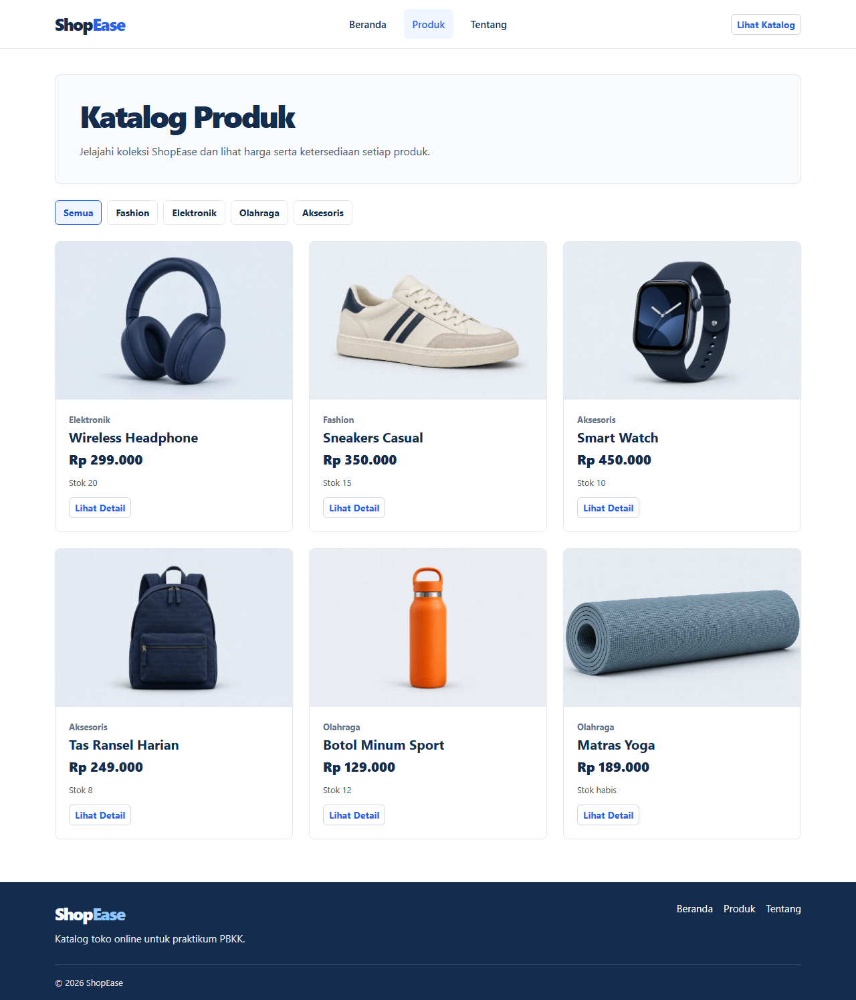
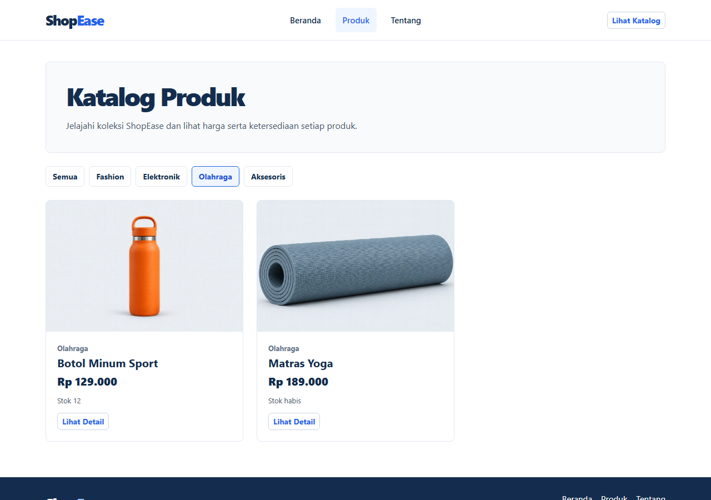
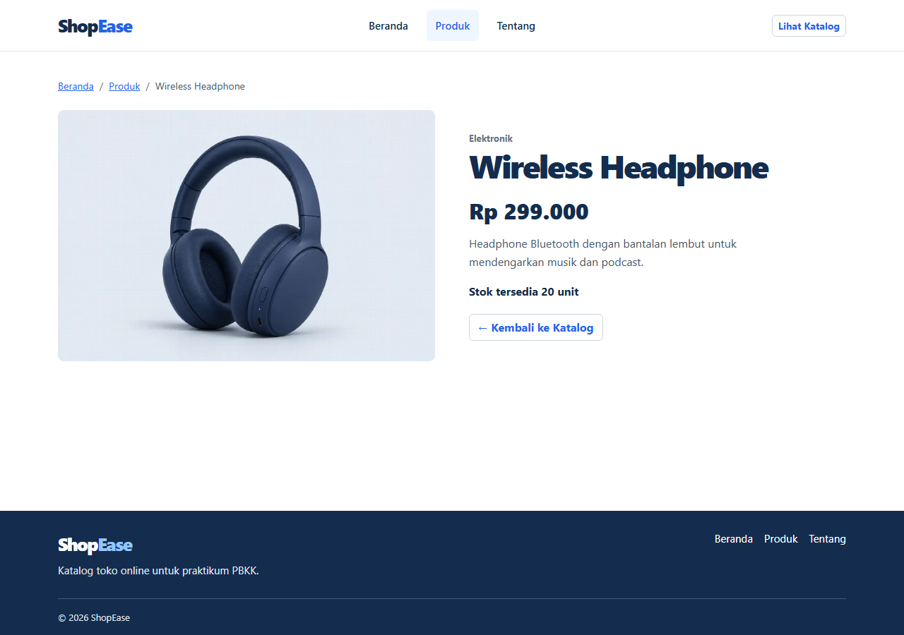
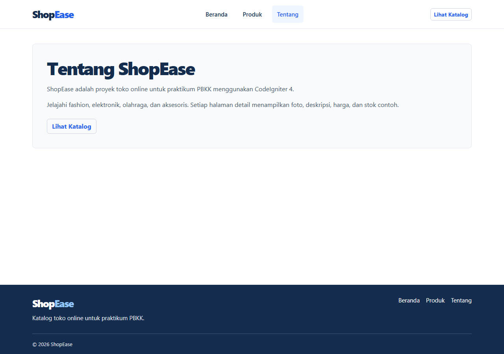
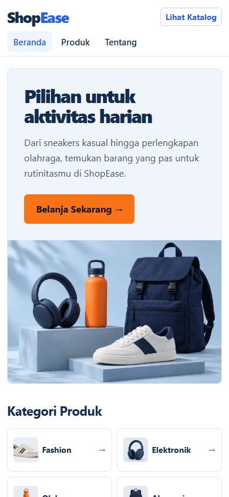
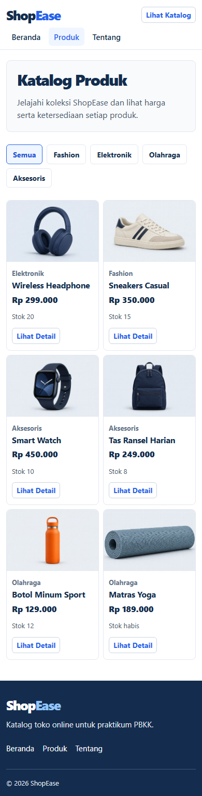

# ShopEase · Pertemuan 10

Praktikum PBKK dengan CodeIgniter 4.7.6 dan Bootstrap 5.3.9. Pertemuan ini melatih routing eksplisit, parameter ID dinamis, pengiriman data dari controller ke view, dan penggunaan layout bersama.

## Fitur

- Landing page dengan hero, empat kategori, enam produk unggulan, dan navigasi responsif.
- Katalog dengan foto, harga Rupiah, stok, serta filter kategori sederhana. Contoh URL adalah `/products?category=olahraga`.
- Detail produk dengan breadcrumb dan tautan kembali ke katalog. ID yang tidak tersedia menghasilkan HTTP 404.
- Halaman Tentang ShopEase.

## Cara Menjalankan

Siapkan PHP 8.2 atau lebih baru dengan ekstensi `intl` dan `mbstring`, serta Composer 2. Dari folder `Pertemuan 10`, jalankan perintah berikut.

```powershell
composer install
php spark serve
```

Buka [beranda](http://localhost:8080/) atau [contoh detail produk](http://localhost:8080/products/1). Aplikasi berjalan dengan konfigurasi bawaan tanpa MySQL atau file `.env`.

## Implementasi MVC dan Routing

| File atau folder | Tanggung jawab |
| --- | --- |
| `app/Config/Routes.php` | Memetakan empat rute GET dan menonaktifkan Auto Routing. |
| `app/Controllers/HomeController.php` | Menyiapkan data beranda dan merender halaman Tentang. |
| `app/Controllers/ProductController.php` | Memilih produk untuk katalog, filter kategori, dan detail berdasarkan ID. |
| `app/Config/Catalog.php` | Menyediakan array kategori dan produk dengan ID sebagai kunci. |
| `app/Views/frontend/` dan `app/Views/layouts/store.php` | Merender halaman, memakai ulang grid produk, serta menyediakan navbar dan footer bersama. |
| `public/css/` dan `public/images/shopease/` | Menyimpan Bootstrap, stylesheet ShopEase, dan gambar WebP lokal. |

Controller memilih data dari `Catalog.php` sebelum mengirimkannya ke view. Pertemuan 10 belum menggunakan Model database atau CRUD.

Aset gambar produk dibuat dengan ImageGen dan disimpan lokal. Enam foto katalog memakai latar studio slate muda. Hero menampilkan headphone, sneakers, ransel navy, dan botol olahraga oranye.

### Rute

| Metode | URL | Handler |
| --- | --- | --- |
| GET | `/` | `HomeController::index` |
| GET | `/products` | `ProductController::index` |
| GET | `/products/(:num)` | `ProductController::detail/$1` |
| GET | `/about` | `HomeController::about` |

Rute `/products/(:num)` meneruskan ID numerik ke `ProductController::detail()`. Misalnya, `/products/1` mengambil Wireless Headphone dari array katalog. ID yang tidak tersedia menghasilkan HTTP 404.

## Dokumentasi Tampilan

Screenshot diambil dengan Chrome headless saat ShopEase berjalan melalui `php spark serve`. Lebar viewport desktop adalah 1280 piksel dan lebar viewport ponsel 390 piksel.

### Homepage

#### Beranda desktop

Navbar dan hero memperkenalkan ShopEase serta menyediakan tombol untuk membuka katalog.



#### Beranda halaman penuh

Tampilan dari navbar hingga footer, termasuk kategori, enam produk unggulan, dan ringkasan fitur katalog.



### Katalog Produk

#### Katalog desktop

Grid tiga kolom menampilkan enam produk beserta harga, stok, dan tautan detail.



#### Katalog terfilter

Filter Olahraga menampilkan Botol Minum Sport dan Matras Yoga.



### Detail Produk

#### Wireless Headphone

Rute `/products/1` menampilkan foto, kategori, harga, deskripsi, dan stok produk beserta breadcrumb dan tautan kembali.



### Halaman About

#### Tentang ShopEase

Halaman `/about` menjelaskan tujuan proyek praktikum dan menyediakan tautan untuk menjelajahi katalog.



### Tampilan Mobile

#### Beranda mobile

Navbar, teks hero, dan foto tersusun vertikal pada lebar 390 piksel.



#### Katalog mobile

Filter kategori dan grid dua kolom menampilkan seluruh produk pada layar ponsel.



## Pengujian

### Stage 2

- `php -l` lulus untuk 10 file PHP. `php spark routes` menampilkan empat rute GET dengan Auto Routing nonaktif di konfigurasi.
- Uji HTTP pada server Spark mengembalikan 200 untuk beranda, katalog, Tentang, detail ID 1–6, dua stylesheet, dan tujuh gambar WebP. ID yang hilang atau bukan angka, rute tak terdaftar, dan `POST /products` mengembalikan 404.
- Filter Olahraga menampilkan dua produk. Nilai kategori tak dikenal mengembalikan katalog lengkap.
- Chrome headless memeriksa tampilan pada 390, 768, dan 1280 piksel tanpa gulir horizontal atau gambar gagal dimuat. Alur klik kategori, katalog terfilter, dan detail berhasil.
- Uji HTTP berjalan dengan pengaturan driver database yang sengaja dibuat tidak valid di proses server uji.

### Stage 2.1

- `composer check-platform-reqs` lulus pada PHP 8.5.12. `php spark routes` menampilkan empat rute GET.
- Uji HTTP mengembalikan 200 untuk beranda, katalog, filter Olahraga, detail ID 1, dan Tentang. Detail dengan ID tak tersedia atau bukan angka, rute tak terdaftar, dan `POST /products` mengembalikan 404.
- Chrome headless memeriksa judul, stylesheet, dan pemuatan gambar sebelum mengambil setiap screenshot. Katalog desktop menampilkan tiga kolom, katalog mobile dua kolom, dan filter Olahraga dua produk.

## Batasan

Katalog, harga, dan stok adalah data simulasi. Pertemuan ini mencakup penelusuran produk. Penyimpanan database, autentikasi, pengelolaan produk, keranjang, checkout, dan transaksi berada di luar cakupan.
