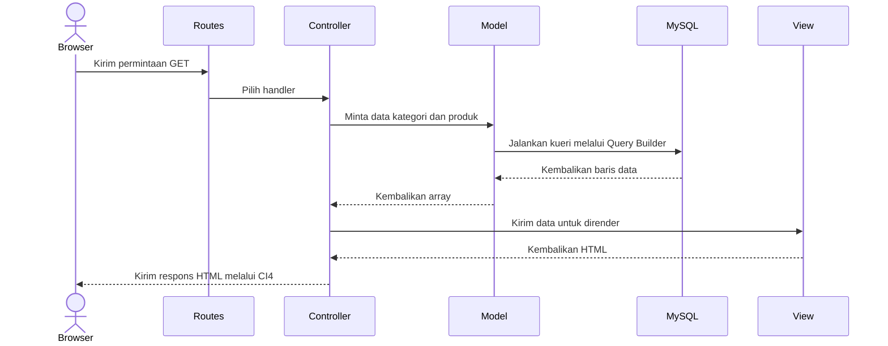
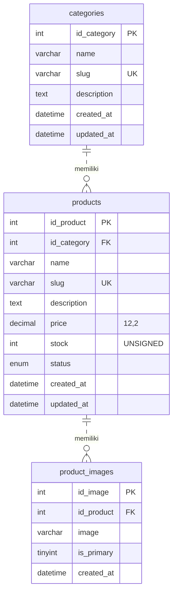
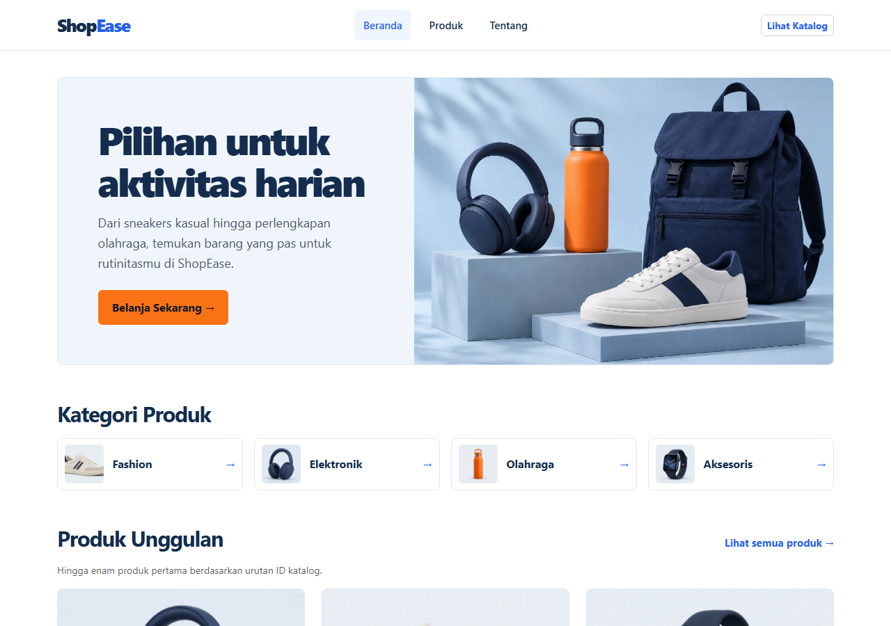
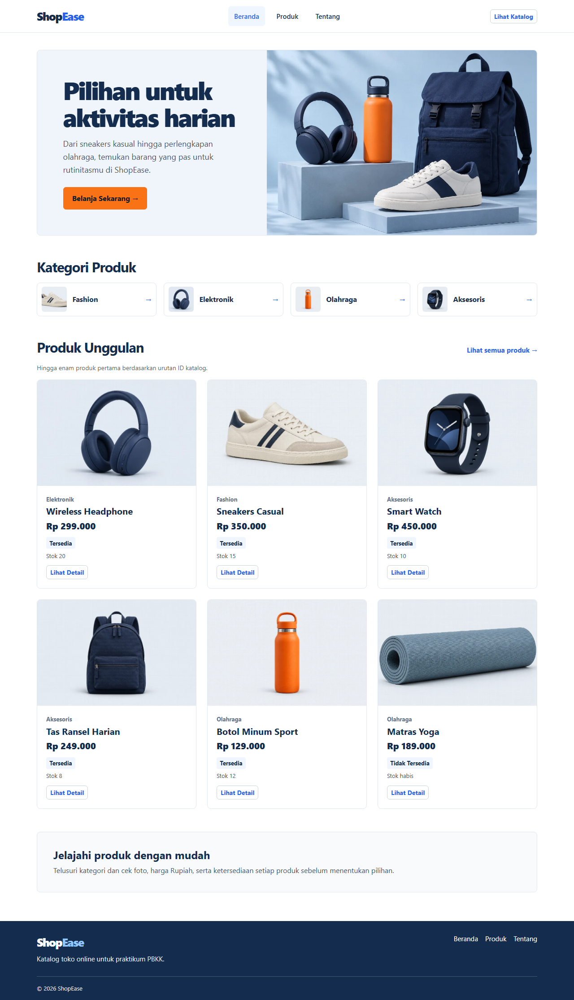
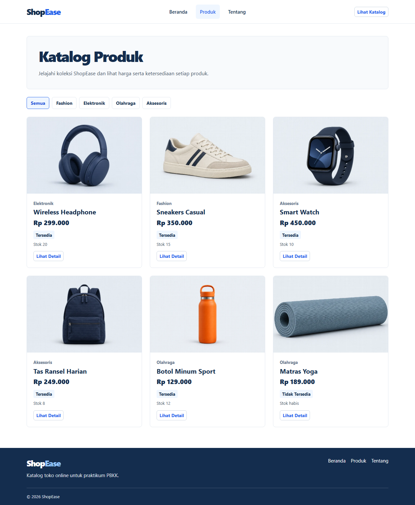
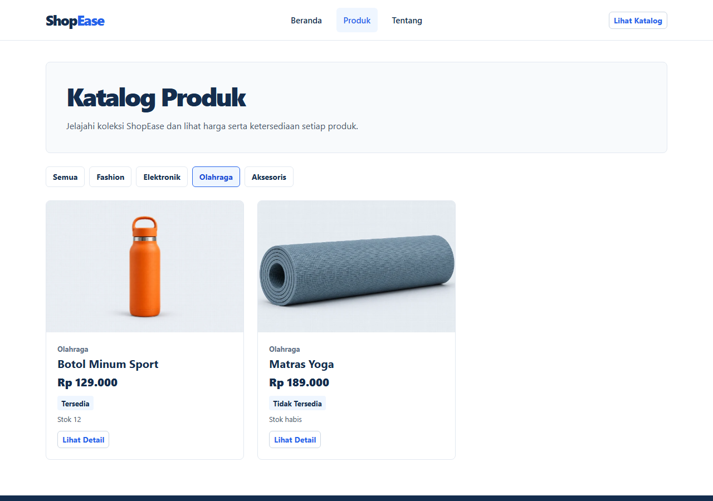
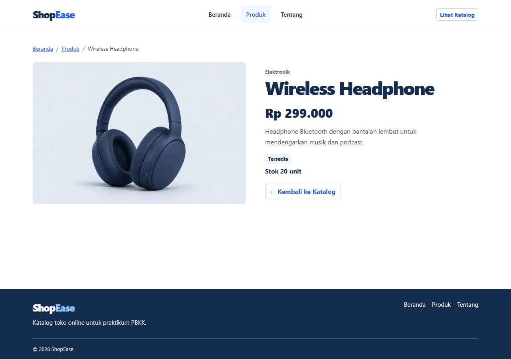
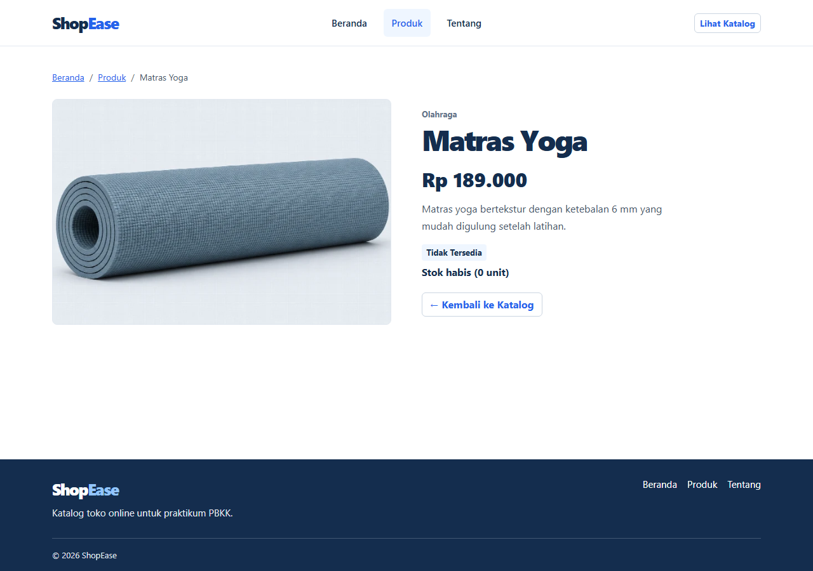
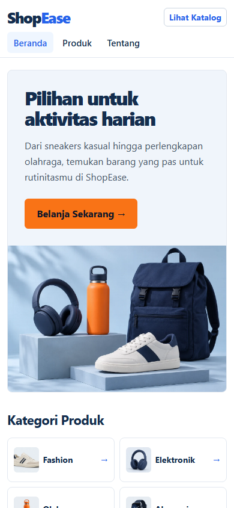
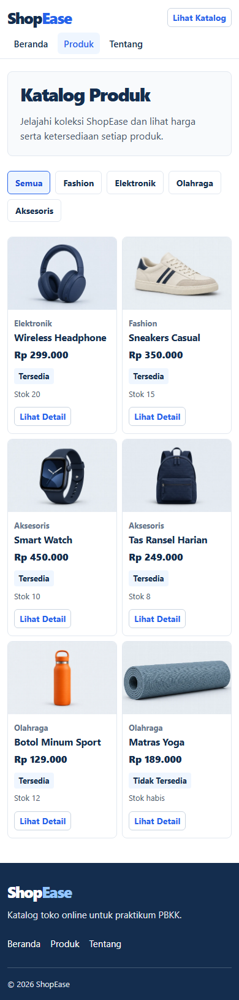

# ShopEase · Pertemuan 11

ShopEase adalah proyek praktikum PBKK untuk menelusuri kategori, katalog, dan detail produk. Pertemuan 11 melanjutkan desain dan rute Pertemuan 10 dengan data katalog yang dibaca dari MySQL melalui Model CodeIgniter 4.

## Tujuan pembelajaran

- Membangun skema relasional yang dapat direproduksi melalui migration dan seeder.
- Menggunakan Model dan Query Builder untuk membaca kategori, produk, dan gambar utama.
- Meneruskan data hasil kueri dari controller ke view untuk beranda, filter katalog, dan detail produk.

## Teknologi

PHP, CodeIgniter 4.7.6, Composer 2, Bootstrap 5.3.9 lokal, serta MySQLi. Pengujian lokal menggunakan PHP 8.5.12 dan MariaDB 10.11.16 dari XAMPP.

## Fitur

- Beranda menampilkan kategori dan hingga enam produk dengan ID terkecil sebagai produk unggulan.
- Katalog publik menampilkan harga Rupiah, stok, status, dan gambar utama. Pengunjung dapat memfilter produk berdasarkan slug kategori.
- Detail produk menampilkan kategori, harga, deskripsi, stok, status, dan breadcrumb. ID yang tidak ditemukan menghasilkan HTTP 404.
- Produk dengan status `tidak_tersedia` tetap dapat dilihat dengan label **Tidak Tersedia**. Kategori kosong memiliki pesan khusus, dan gambar yang kosong atau tidak valid memakai panel **Foto belum tersedia**.

## Perbandingan Pertemuan 10 dan 11

| Aspek               | Pertemuan 10                      | Pertemuan 11                                        |
| ------------------- | --------------------------------- | --------------------------------------------------- |
| Sumber data halaman | Array PHP di `Catalog.php`      | Tabel katalog di `db_shopease_p11`                |
| Filter dan detail   | Pencarian slug dan ID dalam array | Kueri Model berdasarkan slug dan ID                 |
| Gambar utama        | Nama file di array produk         | Record `product_images` dengan `is_primary = 1` |
| Data demo           | Dibaca langsung oleh controller   | Dimasukkan oleh seeder dari `Catalog.php`         |

## Implementasi Model CodeIgniter 4

`Routes.php` memetakan rute GET ke controller. `HomeController` meminta daftar kategori dan enam produk pertama. `ProductController` mencari kategori berdasarkan slug untuk memfilter katalog dan memakai ID numerik untuk detail. Controller meneruskan hasil Model ke view yang menggunakan layout bersama.



| Model                                                    | Peran                                                                                                                                                                                                                                                                                               |
| -------------------------------------------------------- | --------------------------------------------------------------------------------------------------------------------------------------------------------------------------------------------------------------------------------------------------------------------------------------------------- |
| [CategoryModel.php](app/Models/CategoryModel.php)         | `findAll()` membaca kategori dan `findBySlug()` mencari kategori untuk filter.                                                                                                                                                                                                                  |
| [ProductModel.php](app/Models/ProductModel.php)           | `findForCatalog()` menggabungkan kategori dan produk melalui Query Builder, dengan filter ID kategori dan batas opsional. `findDetail()` membaca satu produk dan menyertakan gambar utamanya. `findBySlug()`, `findAvailable()`, dan `findByCategory()` tersedia untuk pembacaan terkait. |
| [ProductImageModel.php](app/Models/ProductImageModel.php) | `findPrimaryForProduct()` mengambil gambar utama satu produk. `findPrimaryByProductIds()` mengambil gambar utama seluruh daftar dalam satu kueri.                                                                                                                                               |

Jika beberapa gambar ditandai sebagai utama, Model memilih ID gambar terkecil. Helper katalog memvalidasi path lokal relatif terhadap `public/` sebelum membentuk URL gambar.

### Rute

| Rute                     | Handler                                                             |
| ------------------------ | ------------------------------------------------------------------- |
| `GET /`                | `HomeController::index`                                           |
| `GET /products`        | `ProductController::index`. Contoh filter `?category=olahraga`. |
| `GET /products/(:num)` | `ProductController::detail`                                       |
| `GET /about`           | `HomeController::about`                                           |

## Struktur database

Skema `db_shopease_p11` mengikuti HOL Product Management dengan tabel gambar terpisah, harga `DECIMAL(12,2)`, stok `INT UNSIGNED`, dan status `tersedia` atau `tidak_tersedia`.



Satu kategori dapat memiliki nol atau lebih produk. Satu produk dapat memiliki nol atau lebih gambar. Kedua foreign key menggunakan `ON UPDATE CASCADE`. Penghapusan kategori yang masih memiliki produk dibatasi dengan `ON DELETE RESTRICT`. Penghapusan produk menghapus baris gambar terkait melalui `ON DELETE CASCADE`.

Tiga migration membentuk skema dan indeks. `CatalogSeeder` memasukkan **4 kategori, 6 produk, dan 6 gambar utama** dalam satu transaksi pada database kosong. Seeder menggunakan slug yang sudah ada dan mempertahankan atribut serta gambar produk yang tersimpan saat dijalankan ulang.

## Dokumentasi tampilan

Tangkapan berikut berasal dari aplikasi Pertemuan 11 yang berjalan dengan data demo. Lebar viewport desktop 1280 piksel dan mobile 390 piksel.

### Beranda

**Desktop.** Navbar, hero, dan navigasi ke kategori katalog.



**Halaman penuh.** Beranda dari navbar hingga footer, termasuk enam produk unggulan berdasarkan urutan ID.



### Katalog

**Desktop.** Grid enam produk dengan harga, stok, status, dan tautan detail.



**Filter Olahraga.** Pilihan kategori menampilkan Botol Minum Sport dan Matras Yoga.



### Detail produk

**Wireless Headphone.** Detail ID 1 menampilkan gambar utama, kategori Elektronik, harga, dan stok.



**Matras Yoga.** Detail ID 6 menampilkan stok 0 dan label **Tidak Tersedia**.



### Tampilan mobile

**Beranda.** Hero tersusun dalam satu kolom.



**Katalog.** Filter kategori diikuti grid produk dua kolom.



## Struktur file utama

| Lokasi                                                                                | Isi                                                   |
| ------------------------------------------------------------------------------------- | ----------------------------------------------------- |
| [app/Config/Routes.php](app/Config/Routes.php)                                         | Rute eksplisit dan pengaturan Auto Routing            |
| [app/Controllers/](app/Controllers/)                                                   | `HomeController` dan `ProductController`          |
| [app/Models/](app/Models/)                                                             | Model kategori, produk, dan gambar                    |
| [app/Database/Migrations/](app/Database/Migrations/)                                   | Tiga migration tabel katalog                          |
| [app/Database/Seeds/CatalogSeeder.php](app/Database/Seeds/CatalogSeeder.php)           | Seeder data demo                                      |
| [app/Views/frontend/](app/Views/frontend/) dan [app/Views/layouts/](app/Views/layouts/) | Beranda, katalog, detail, Tentang, dan layout bersama |
| [app/Helpers/catalog_helper.php](app/Helpers/catalog_helper.php)                       | Validasi path gambar, format harga, dan label status  |

## Instalasi dan konfigurasi database

1. Siapkan PHP yang memenuhi `composer.lock` dengan ekstensi `intl`, `mbstring`, dan `mysqli`, serta Composer 2.
2. Jalankan `composer install` dari direktori `Pertemuan 11`.
3. Aktifkan MySQL melalui XAMPP dan siapkan database `db_shopease_p11`.
4. Gunakan [template env](env) untuk membuat `.env` lokal jika diperlukan. Isi `database.default.hostname`, `database.default.port`, dan `database.default.database`, gunakan `MySQLi` sebagai driver, lalu masukkan kredensial lokal di `.env`. Port XAMPP yang terverifikasi adalah 3307. Sesuaikan port dengan `my.ini` untuk instalasi lain.

### Migration dan seeder

Periksa tabel pada database tujuan sebelum menjalankan migration. Jika tabel katalog sudah ada di luar riwayat migration proyek, periksa skema dan data terlebih dahulu.

```powershell
php spark migrate
php spark migrate:status
php spark db:seed CatalogSeeder
```

### Menjalankan aplikasi

```powershell
php spark serve
```

Buka [beranda](http://localhost:8080/) atau [contoh detail produk](http://localhost:8080/products/1). Jika memilih port alternatif, gunakan URL yang dicetak oleh Spark dan sesuaikan `app.baseURL` pada konfigurasi lokal.

### Batasan

Pertemuan 11 mencakup penelusuran katalog publik dan detail produk. CRUD, autentikasi, dashboard admin, keranjang, checkout, dan transaksi berada di luar cakupan.
